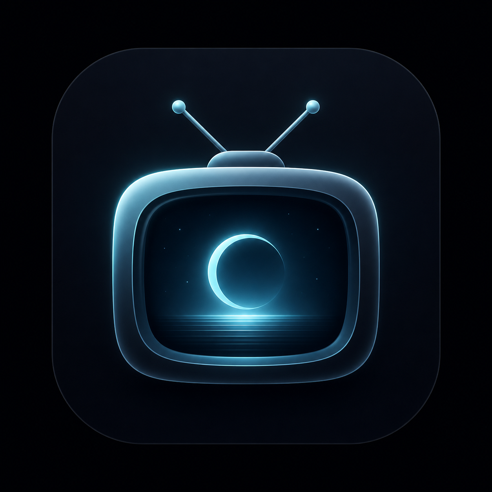

# Moglog

<p align="center">
  
</p>

<p align="center">
  A clean and modern TV show tracking app for Android.
</p>

<p align="center">
  <a href="https://github.com/tshivaneshk/Moglog/releases/latest"></a>
  
  
  
  
  <a href="LICENSE"></a>
</p>

---

## Overview

Moglog helps you keep track of TV series, web shows, and animated series in one place. You can record what you are currently watching, plan shows to watch later, and mark completed titles.

The app works offline by default and can back up your watchlist to the cloud when you connect your Google account.

---

## Features

- **Organized Watchlist**: Sort your shows into three clear tabs: Watching, Planned, and Done.
- **Show Search**: Search for titles, view posters, cast details, overviews, and ratings powered by TMDB.
- **Offline Support**: All your data is saved locally on your device. You can browse, add, and edit shows without an internet connection.
- **Cloud Backup and Sync**: Sign in with Google to back up your watchlist to Firebase Cloud Firestore.
- **Flexible Sync Settings**: Choose immediate automatic sync or manual sync whenever you prefer.
- **Guest Friendly**: Start using the app immediately as a guest. When you sign in or sign out, your local watchlist remains safe.
- **Clean Design**: Built with Material 3 in a dark Emerald and Charcoal theme, featuring smooth animations and support for both portrait and landscape modes.

---

## Tech Stack

| Component | Technology |
| :--- | :--- |
| **User Interface** | Jetpack Compose, Material 3 |
| **Programming Language** | Kotlin |
| **Architecture** | MVVM (Model-View-ViewModel) |
| **Local Database** | Room (SQLite) |
| **Cloud Services** | Firebase Authentication, Cloud Firestore |
| **Dependency Injection** | Dagger Hilt |
| **Networking** | Retrofit, OkHttp |
| **Image Loading** | Coil |

---

## Installation

### Download the APK

You can download the pre-built APK file directly on your Android phone:

1. Open the [Releases page](https://github.com/tshivaneshk/Moglog/releases/latest).
2. Download `Moglog-v1.0.0.apk`.
3. Open the downloaded file to install it on your device (Android 7.0 or higher required).

---

## Building from Source

### Prerequisites

- Android Studio Ladybug or newer
- JDK 17 or higher
- Android SDK (API 24 to API 35)

### Steps

1. Clone this repository:
   ```bash
   git clone https://github.com/tshivaneshk/Moglog.git
   cd Moglog
   ```

2. Add Firebase configuration:
   - Create a project on the [Firebase Console](https://console.firebase.google.com/).
   - Enable **Google Sign-In** under Authentication.
   - Create a **Firestore Database**.
   - Download `google-services.json` and place it inside the `app/` folder (refer to `app/google-services.json.example`).

3. Add your TMDB API Key:
   - Get an API key from [The Movie Database (TMDB)](https://www.themoviedb.org/).
   - Enter your key in the app Settings screen.

4. Build and install:
   ```bash
   ./gradlew assembleDebug
   ```

---

## License

This project is licensed under the [MIT License](LICENSE).
